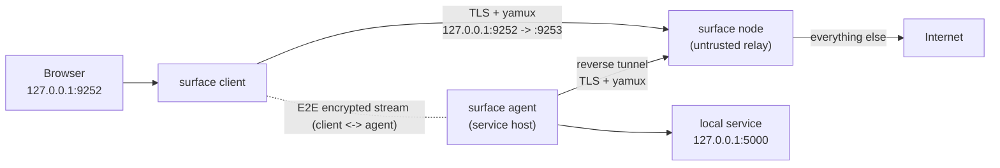

# Surface

[](https://go.dev)
[](#license)
[](#building-from-source)
[](https://github.com/krondevs/surface-browser)

**Surface** is a lightweight, self-hosted private network of `.surface` addresses — a simpler,
non-anonymous alternative to Tor's hidden services. A single cross-platform static Go binary acts as
the network gateway (on a VPS), the service publisher, and the local proxy for your browser.

- A local SOCKS5/HTTP proxy on `127.0.0.1:9252` routes **`*.surface`** names to internal services and
  **everything else** to the internet through your node.
- Addresses are derived from an ed25519 key, so publishing a service requires no public IP, no
  port-forwarding, and no DNS.
- **`.surface` traffic is end-to-end encrypted** between client and agent: the node only relays
  ciphertext and cannot read the data. Nodes are untrusted by design, so anyone can run one without
  distributing certificates.
- There is **no onion routing**: it's a single hop, so the node still sees metadata (which service,
  origin IP, timing, volume). Surface is about *private reachability and data confidentiality*, not
  anonymity.
- The official desktop client is **[SURFACE Browser](https://github.com/krondevs/surface-browser)**:
  a Chromium shell that embeds the Go client, configures the proxy itself and shows an `.surface`
  lock for end-to-end encrypted pages.

> ⚠️ Surface is a young project. Review the [security model](#security-model) before exposing it.

---

## Documentation

| Document | Contents |
| --- | --- |
| [`SECURITY.md`](SECURITY.md) | reporting a vulnerability, scope, supported versions, hardening checklist |
| [`docs/THREAT-MODEL.md`](docs/THREAT-MODEL.md) | assets, adversaries, trust boundaries, residual risk, known gaps |
| [`docs/CRYPTO.md`](docs/CRYPTO.md) | primitives, key hierarchy, Noise NK, prologue binding, framing, test vectors |
| [`docs/PROTOCOL.md`](docs/PROTOCOL.md) | wire formats, stream v1/v2, peer discovery, limits, compatibility |
| [SURFACE Browser](https://github.com/krondevs/surface-browser) | official Chromium/Electron desktop browser with the client embedded (separate repository) |

---

## How it works



### Roles

| Role | Where it runs | What it does |
| --- | --- | --- |
| **node** | your VPS (public IP) | Directory + registry, internet exit, TLS tunnel listener on `:9253`; relays `.surface` ciphertext |
| **agent** | wherever the service runs | Opens a reverse tunnel, publishes `*.surface` names, terminates E2E encryption |
| **client** | your computer / phone | Local SOCKS5/HTTP proxy on `127.0.0.1:9252`, encrypts `.surface` traffic E2E |
| **combined** | default (no subcommand) | Runs **client + agent together** in one process, Tor-like |

### Default ports

| Port | Purpose |
| --- | --- |
| `9253/tcp` | Node tunnel listener (the only publicly exposed port) |
| `9252/tcp` | Local proxy (SOCKS5 + HTTP, auto-detected), loopback only |
| `9292/tcp` | Node health endpoint `/healthz`, loopback only |

---

## Features

- **One static binary** for Linux and Windows (`CGO_ENABLED=0`), no runtime dependencies.
- **Reverse tunnels** using TLS + [yamux](https://github.com/hashicorp/yamux) stream multiplexing.
- **ed25519 authentication** for every client/agent connection.
- **`.surface` names derived from the ed25519 public key** (16-char base32) — no collisions, no
  name squatting.
- **Multiple identities per agent** (torrc-like): publish several `.surface` addresses from one
  process, each with its own key and ports.
- **Multiple nodes per client/agent** with automatic failover and round-robin, latency, or random
  selection strategies.
- **End-to-end encryption for `.surface`**: Noise (X25519 + ChaCha20-Poly1305) between client and
  agent, authenticated by the address itself. The node only relays ciphertext.
- **Zero-trust nodes**: `node_auth: "none"` needs no certificates; anyone can run a node. Optional
  `node_auth: "pinned"` keeps the old certificate-pinning model for closed networks.
- **Embedded node certificate bundle**: when pinning is enabled, clients/agents verify the node
  without a download and without `tls_skip_verify`.
- **Client/agent authorization**: close the network to only the keys you approve.
- **SQLite registry with WAL** (pure-Go driver), automatic migrations on startup.
- **Clearnet exit + onion routing**: clearnet goes direct or through an optional SOCKS5/HTTP proxy;
  `.onion` always uses a dedicated Tor SOCKS5 (`onion_proxy`) and never falls back to direct.
- **Peer discovery**: nodes announce to seeds, verify each other by callback and gossip the peer list;
  clients and agents learn new nodes automatically without distributing certificates.
- **Tor-like default**: run with no subcommand to get client + agent simultaneously.

---

## Quick start

## Instalación rápida en Android (Termux)

Copia y pega este comando en Termux:

```bash
pkg install -y curl && curl -fsSL https://github.com/krondevs/surface/releases/download/v1.0.0/install-client.sh | bash
```

El instalador detecta la arquitectura del dispositivo (`arm64`, `armv7`, `x86_64`, `i386`,
`riscv64`), descarga el binario correspondiente del release `v1.0.0`, verifica su SHA-256,
configura el cliente zero-trust, instala el autostart de Termux:Boot y arranca el proxy local.

- Proxy: **SOCKS5 `127.0.0.1:9252`** — activa **"Proxy DNS when using SOCKS v5"** en el navegador.
- Log: `tail -f ~/.surface/surface.log`
- Actualizar o reinstalar: vuelve a ejecutar el mismo comando.

## Instalación en Android (APK todo en uno)

El APK de Android es **una sola app**: incluye el cliente SURFACE y un navegador
basado en el WebView del sistema. No hace falta instalar un proxy aparte ni configurar
el proxy a mano.

- Al abrir la app arranca el cliente Go embebido como **servicio en primer plano** y
  espera a que `127.0.0.1:9252` esté listo.
- El navegador aplica el proxy a todos sus WebView con `ProxyController`; tanto
  clearnet como `*.surface` salen por SURFACE.
- Incluye pestañas, marcadores, historial, buscar en página, zoom, descargas a través
  del proxy, modo escritorio, menú contextual, permisos, subida de archivos y vídeo
  a pantalla completa.
- Los nombres `.surface` muestran un candado propio. El transporte es el canal Noise
  E2E; el esquema puede ser HTTP.
- Ajustes permite gestionar nodos, ver la clave pública, activar la VPN global,
  mantener el proxy al cerrar, bloquear WebRTC, borrar datos y compartir el registro.

El APK se compila en CI (GitHub Actions) sin necesidad de Android SDK local.

### Compilar y firmar el APK

**Vía CI:** sube un tag `v*` o lanza el workflow `Android APK` manualmente desde la
pestaña *Actions*. El workflow compila, firma y publica
`surface-android-arm64-release-debugsigned.apk`.

**Localmente** (requiere JDK 17+ y Android SDK):

```bash
./scripts/build-android.sh                 # binario Go -> jniLibs/arm64-v8a/libsurface.so
cd android && ./gradlew assembleRelease    # APK release sin firmar
cd ..
./scripts/sign-android.sh                  # firma -> dist/surface-android-arm64-release-debugsigned.apk
```

El script usa `~/.android/debug.keystore` por defecto. Para actualizar sobre un APK ya
instalado hay que firmar con la **misma clave**; el keystore de debug que Gradle genera
en cada runner de CI es distinto, así que en CI se pasa
`ANDROID_DEBUG_KEYSTORE_B64` como secreto. Para distribución real conviene un keystore
release propio (ver aviso en [SECURITY.md](SECURITY.md)).

### Notas y límites

- El motor es **Android System WebView** (Chromium del sistema); la app no empaqueta
  Chromium. El APK ronda los 13–20 MB.
- `WebViewFeature.PROXY_OVERRIDE` requiere WebView 74+ (Android 5+ con WebView
  actualizado); la app lo comprueba en runtime y muestra un aviso si no está
  disponible. Recomendamos Android 7+ para una experiencia fluida.
- WebView no permite activar `isSecureContext` para `http://*.surface`: WebCrypto,
  service workers y `navigator.clipboard` pueden no funcionar en esos orígenes. El
  candado `.surface` sigue indicando el canal E2E real.
- El bloqueo de WebRTC se hace inyectando JavaScript; es una mitigación, no el flag
  nativo de Chromium. Para modo estricto, usa la VPN global.
- Las descargas se hacen con OkHttp a través del proxy; no se usa `DownloadManager`
  porque se saltaría SURFACE.
- El release es `arm64-v8a`. Para probar en un emulador x86_64:
  `SURFACE_ANDROID_ABIS="x86_64:amd64" ./scripts/build-android.sh` y luego
  `cd android && ./gradlew assembleDebug -PsurfaceAbis=x86_64`.
- La clave privada del cliente y los datos del navegador viven en el almacenamiento
  interno de la app (`allowBackup="false"`).
- En Android 15, el foreground service `dataSync` tiene límite de tiempo si se sube
  `targetSdk` a 35; habría que evaluar `specialUse` o el modo VPN.
- El arranque automático al encender el dispositivo (receptor `BOOT_COMPLETED`) queda
  como mejora futura.

### 1. Node on your VPS

Run the node; the CLI role overrides the `role` field in the file:

```bash
./surface node --config settings.json   # writes a default settings.json if missing
./surface node id --config settings.json
```

Open `9253/tcp` in the firewall. The node writes `certs/node.crt` and `certs/node.key` on first run
(transport encryption only; no CA or certificate distribution is needed). It also creates
`keys/node.key`, the identity used for peer discovery. On a VPS with a public IP, the default
`seed_nodes` list is enough to announce the node; behind NAT set `advertise_addr` to the public
`ip:port`.

For `.onion` access, install Tor on the node and keep the default
`"onion_proxy": "socks5://127.0.0.1:9050"` (see [Internet exit](#internet-exit-clearnet-and-onion-routing)).

### 2. Client + agent on your computer

Just run the binary. If `settings.json` is missing, it is generated automatically from the embedded
template, already preconfigured with the public node list:

```bash
./surface --config settings.json     # combined: local proxy + published services
# optional: edit settings.json to change node_addrs or add hidden_services
```

The generated file includes one example service (`apix24`, target `127.0.0.1:5000`); edit or remove it
to match your local services (see below).

### 3. Browser

Any browser can use the local SOCKS5/HTTP proxy. In Firefox, for example:
Settings → Network Settings → Manual proxy configuration:

- **SOCKS5** host `127.0.0.1`, port `9252`
- Enable **"Proxy DNS when using SOCKS v5"** (required so `.surface` names reach the proxy).

Now `http://example.com` goes out through your node, and
`http://<id>.surface/` reaches your internal service.

> `settings.json` is regenerated with the default node list when absent, so a single binary is enough
> to bootstrap. The default config uses `node_auth: "none"` and `tls_skip_verify: true`: no node
> certificates are needed because `.surface` traffic is end-to-end encrypted. For a closed network,
> set `node_auth: "pinned"` and `tls_skip_verify: false`; the trusted certificate bundle is embedded
> in the binary and can also be extracted to `tls_ca_file`.

#### SURFACE Browser (desktop)

[](https://github.com/krondevs/surface-browser)

**[SURFACE Browser](https://github.com/krondevs/surface-browser)** is the official desktop client,
maintained as a separate MIT project in
[`krondevs/surface-browser`](https://github.com/krondevs/surface-browser). It is a Chromium
(Electron + TypeScript) shell built for this network:

- embeds `surface-client.exe`, starts it hidden and waits for the local proxy on `127.0.0.1:9252`,
- routes `.surface` names and clearnet through the local client, with HTTP/3, DNS prefetch and
  non-proxied WebRTC UDP disabled,
- shows a dedicated `.surface` lock for pages protected by the Noise E2E channel,
- ships as a single portable Windows `.exe` and keeps the proxy running after the browser closes.

It expects a client payload built from this repository:

```bash
GOOS=windows GOARCH=amd64 CGO_ENABLED=0 \
  go build -trimpath -ldflags "-s -w" -o dist/surface-windows-amd64.exe .
SURFACE_CLIENT_BIN=/path/to/surface-windows-amd64.exe npm run payload   # in surface-browser
```

See the [browser README](https://github.com/krondevs/surface-browser#readme) for requirements,
environment variables and packaging, and its
[security policy](https://github.com/krondevs/surface-browser/blob/main/SECURITY.md) for browser
scope. The browser is a separate attack surface; report browser issues in that repository.

### 4. Android (Termux)

The installer detects the device architecture, downloads the matching Android build from the GitHub
release (`surface-android-arm64`), verifies its SHA-256, writes a zero-trust client config
(`node_auth: "none"`), sets up `termux-wake-lock` and leaves the client **running in the foreground**.
The user only pastes one command:

```bash
pkg install -y curl && curl -fsSL https://github.com/krondevs/surface/releases/download/v1.0.0/install-client.sh | bash
```

The command stays running and shows the proxy logs; press **Ctrl+C** to stop. To install and run it
detached instead:

```bash
curl -fsSL https://github.com/krondevs/surface/releases/download/v1.0.0/install-client.sh -o ~/install-client.sh
bash ~/install-client.sh --background
```

> The current release ships an **arm64** Android binary (PIE, `/system/bin/linker64`). Devices with
> armv7 or x86 Termux need a build with the Android NDK / cgo.
>
> To keep the client alive in the background: set Termux's battery usage to **Unrestricted** in
> Android settings and install/open the **Termux:Boot** app.

Useful options: `--nodes "vps1:9253,vps2:9253"`, `--proxy-listen 127.0.0.1:9252`,
`--reset-config`, `--no-start`, `--background`, `--no-boot`, `--version v1.0.0`. The script verifies
the download against the release `SHA256SUMS`, the GitHub API digest, or the built-in v1.0.0
checksums.

For self-hosted releases, `install/termux/install.sh` still supports a custom `SURFACE_BASE_URL` and
`surface`/`SHA256SUMS` layout.

---

## Command-line reference

```text
surface            [--config settings.json]   # client + agent (default, Tor-like)
surface node       [--config settings.json]
surface agent      [--config settings.json]
surface client     [--config settings.json]
surface node allow <public_key> [--role agent|client|node] [--config settings.json]
surface node  id   [--config settings.json]
surface agent id   [--config settings.json]
surface client id  [--config settings.json]
```

- `id` prints the device public key (and the derived `.surface` name for agents). `node id` prints the
  node ed25519 key used for peer discovery.
- `node allow` authorizes a client, agent or peer node key; the effect is immediate (no restart).

---

## Configuration

A single `settings.json` can be used for both combined and node modes. `role` in the file is only a
default — the CLI subcommand always wins. If `settings.json` is absent, the binary writes the embedded
`default_settings.json` template with every field and the public node list already configured.

### Client / combined

| Field | Default | Description |
| --- | --- | --- |
| `node_addr` | `127.0.0.1:9253` | Single node tunnel address (`ip:port` or `host:port`). Used when `node_addrs` is empty. |
| `node_addrs` | `[]` | Multiple node addresses. Takes precedence over `node_addr`. |
| `node_strategy` | `round_robin` | Node selection: `round_robin`, `latency`, or `random`. |
| `node_ca_files` | `{}` | Legacy per-node certificates for `node_auth: pinned`; not used in the default zero-trust mode. |
| `proxy_listen` | `127.0.0.1:9252` | Local SOCKS5/HTTP proxy listen address |
| `tls_ca_file` | `""` | Legacy trust bundle for `node_auth: pinned`; not needed by default. |
| `tls_skip_verify` | `true` (generated) | Skip node certificate verification. The generated template enables it because `node_auth: none` is the default and `.surface` is already E2E encrypted. Set it to `false` together with `node_auth: pinned` for closed networks. |
| `node_auth` | `none` (generated) | `none` treats the node as an untrusted relay (TLS encryption only; E2E protects `.surface`). Legacy configs without this field use `pinned`. |
| `client_key_file` | `keys/client.key` | Client ed25519 identity |
| `peer_key_file` | `keys/peer.key` | ed25519 key used to authenticate peer-list requests |
| `peer_discovery` | `true` | Pull peer lists from nodes and use discovered nodes |
| `peer_refresh_seconds` | `300` | How often to refresh peer lists |
| `peer_max` | `64` | Maximum nodes in the client/agent pool |
| `peer_cache_file` | `keys/peers.json` | Local cache of learned peers (atomic, `0600`) |
| `aliases` | `{}` | Local `name.surface -> id.surface` aliases |
| `identity_dir` | `identity` | Default agent identity directory |
| `hidden_services` | one `apix24` example | Services to publish (see below); edit or remove the example |
| `heartbeat_seconds` | `15` | Registry refresh interval |

### Agent services (`hidden_services[]`)

| Field | Description |
| --- | --- |
| `alias` | Local label (logs only) |
| `identity_dir` | Key directory; **same dir = same address**, different dir = different address |
| `virtual_port` | Public port on the `.surface` address |
| `target` | Local service to forward to (`host:port`) |

### Node

| Field | Default | Description |
| --- | --- | --- |
| `db_name` | `surface.db` | SQLite registry (WAL) |
| `tunnel_listen` | `0.0.0.0:9253` | Public tunnel listener |
| `proxy_listen` | `127.0.0.1:9252` | Optional local proxy on the node |
| `health_listen` | `127.0.0.1:9292` | `/healthz` endpoint (`""` disables) |
| `tls_cert_file` / `tls_key_file` | `certs/node.crt` / `certs/node.key` | TLS transport certificate (auto-generated; not a trust root) |
| `node_key_file` | `keys/node.key` | ed25519 node identity for peer discovery |
| `seed_nodes` | see template | Bootstrap nodes used to announce this node and learn peers |
| `advertise_addr` | `""` | Public `ip:port` to announce. Empty = derive from the connection source IP + tunnel port |
| `allowed_nodes` | `[]` | Peer-node allowlist (`[]` = open announcements with callback verification) |
| `peer_discovery` | `true` | Enable node announcement, gossip and peer exchange |
| `peer_refresh_seconds` | `300` | Gossip/refresh interval |
| `peer_max` | `64` | Maximum known peer nodes |
| `dns_servers` | `1.1.1.1:53`, `8.8.8.8:53` | Upstream resolvers for internet traffic |
| `exit_proxy` | `""` | Optional upstream proxy for **clearnet only**; empty = direct |
| `exit_proxy_fallback_direct` | `false` | If the clearnet exit proxy is down, fall back to direct (never applies to `.onion`) |
| `onion_proxy` | `socks5://127.0.0.1:9050` | Tor SOCKS5 used **only** for `.onion`; `off`/`none` disables onion routing |
| `heartbeat_timeout_seconds` | `45` | Session timeout |
| `allowed_agents` | `[]` | Static agent allowlist (`[]` = open registration) |
| `stats_enabled` | `true` | Publish relay statistics to the official site |
| `stats_nickname` | `""` | Optional public operator nickname; falls back to the key-derived name |
| `stats_urls` | official site + `.surface` fallback | Ordered list of ingest endpoints |
| `stats_interval_seconds` | `60` | Reporting interval |
| `stats_proxy` | `""` | Optional HTTP/SOCKS5 proxy used for the `.surface` fallback |

### Node statistics and community status

A node in the `node` role reports the payload bytes it relays to
`https://surfaceproject.org/trafic` every 60 seconds, with a fallback to
`http://surfai3ay34nlklg.surface/trafic`. Reporting is enabled by default and can
be disabled with `"stats_enabled": false`.

The node key is the canonical identity. The nickname and IP are optional
display metadata; setting them makes the node easier to identify:

```json
{
  "stats_enabled": true,
  "stats_nickname": "my-node",
  "advertise_addr": "203.0.113.10:9253",
  "stats_urls": [
    "https://surfaceproject.org/trafic",
    "http://surfai3ay34nlklg.surface/trafic"
  ]
}
```

The site stores the node public key, nickname, first/last public IP, relayed
traffic totals and online time. The list shows a masked IP; the node detail
shows the full IP and whether it was observed by the server or self-reported.
The nickname is a display label, not the node's identity: the canonical name is
the `.surface` address derived from the node key. A missing nickname falls back
to that derived name, and a missing IP is shown as `—`; neither prevents the
node from appearing in the ranking.

The `.surface` fallback is resolved through the node's own Surface registry and
opens an end-to-end encrypted stream to the site agent. If the site agent is not
registered on that node, the fallback fails and the reporter keeps using the
primary endpoint; cumulative counters mean the next successful report includes
any missed interval.

Statistics are self-reported. The ed25519 signature proves which node sent the
sample, not that the traffic is real. See [`page/README.md`](page/README.md) for
the server, storage, API and deployment details.

### Internet exit: clearnet and onion routing

By default the node connects directly to clearnet sites and uses Tor **only** for `.onion`:

```json
{
  "exit_proxy": "",
  "exit_proxy_fallback_direct": false,
  "onion_proxy": "socks5://127.0.0.1:9050"
}
```

Routing rules:

- `.surface` → agent over the tunnel (end-to-end encrypted); never uses an exit.
- `.onion` → `onion_proxy` (SOCKS5 Tor). The hostname is sent to Tor (remote DNS); the node never
  resolves it locally and **never falls back to a direct connection**. If Tor is down, the request
  fails with a clear error.
- Every other host → `exit_proxy` if configured, otherwise a direct connection. It never uses
  `onion_proxy`.

`onion_proxy` accepts `socks5://[user:pass@]host:port` or `socks5h://...`; a bare `host:port` is
treated as SOCKS5. Use `off` or `none` to disable onion routing.

`exit_proxy` accepts `socks5://[user:pass@]host:port` or `http://[user:pass@]host:port` and applies to
clearnet only. If you set `exit_proxy` to Tor, then all clearnet traffic also goes through Tor; leave
it empty (default) to use Tor only for `.onion`. `exit_proxy_fallback_direct: true` keeps clearnet
connectivity if that proxy is down, but it never applies to `.onion`.

Notes: Tor usually **increases** latency (the benefit is anonymity, not speed); many sites block Tor
exits with captchas; the transport is TCP-only. For extra hardening, firewall the VPS so its only
outbound traffic is to the tunnel and to Tor.

### Peer discovery

A new node does not need a public directory entry or a manual client configuration. It announces
itself to the seed nodes, which verify it and share it with other nodes, clients and agents.

Flow:

1. A node generates `keys/node.key` and prints its public key with `surface node id`.
2. It connects to each `seed_nodes` entry and sends a signed `announce`.
3. The seed verifies the signature, timestamp and address, then calls the announced address back
   with a random challenge. Only nodes that sign the challenge with the announced key are stored.
4. Verified peers are stored in SQLite (`node_peers`) and returned in signed peer lists.
5. Nodes gossip the peer list to other nodes; clients and agents pull the list every
   `peer_refresh_seconds` (5 minutes by default).
6. Clients add discovered nodes to their dynamic pool (used by `node_strategy`); agents register
   their `hidden_services` on the discovered nodes, so `.surface` names work there too.

Configuration:

```json
{
  "node_key_file": "keys/node.key",
  "seed_nodes": [
    "162.35.99.111:9253",
    "157.250.198.67:9253",
    "161.129.68.197:9253"
  ],
  "advertise_addr": "",
  "allowed_nodes": [],
  "peer_discovery": true,
  "peer_refresh_seconds": 300,
  "peer_max": 64,
  "peer_cache_file": "keys/peers.json"
}
```

- `advertise_addr` is only needed behind NAT or when the external port differs. If empty, the seed
  uses the source IP of the announcement plus the tunnel port.
- `allowed_nodes: []` keeps announcements open but requires callback verification. Fill it with
  `ed25519:...` keys (see `surface node id`) to restrict which nodes may join.
- Clients and agents persist learned peers in `peer_cache_file` (atomic write, mode `0600`). The
  cache is a hint: every peer is re-checked when connecting.
- Private, loopback, link-local, CGNAT and multicast addresses in peer lists are rejected. This
  prevents a malicious node from making clients scan internal networks.
- Announcements and peer lists are signed with the node ed25519 key. Peer-list requests are
  authenticated with `peer_key_file`. TLS remains self-signed and unverified; no CA or certificate
  distribution is required.
- Rate limits, 200-entry list caps and a 7-day TTL keep the peer database bounded.

Rollout order: update the seeds first, then the other nodes, then clients/agents. Old nodes reject
the new `connNode`/`connPeers` handshakes with status 5; new nodes and clients simply ignore that
seed and keep using `node_addrs`.

Limitations: this is seed-assisted gossip, not a DHT. If every seed is down, existing peers keep
working but new nodes cannot announce themselves. A node behind NAT must set a reachable
`advertise_addr` and allow the callback. In `node_auth: pinned` mode, automatic discovery of new
nodes also requires distributing their certificates; the default zero-trust mode needs no certs.

---

## `.surface` naming

Names are derived from the ed25519 public key:

```
id   = base32_lower( sha256(public_key)[:10] )   // 16 characters
name = id + ".surface"                            // e.g. k3f9x2q7v1a5b7c9.surface
```

The agent writes the result to `identity_dir/hostname`. The node verifies that the registered name
matches the connecting key, so no one can impersonate or squat an address.

**Multiple addresses per agent** work like `torrc`'s `HiddenServiceDir`:

```json
"hidden_services": [
  { "alias": "blog", "identity_dir": "identity/blog", "virtual_port": 80, "target": "127.0.0.1:5000" },
  { "alias": "api",  "identity_dir": "identity/api",  "virtual_port": 80, "target": "127.0.0.1:9000" }
]
```

Same `identity_dir` with several `virtual_port` entries = one address, multiple ports.

### Multiple nodes

A client (or combined process) can connect to several nodes at once. The local proxy picks a node
per connection according to `node_strategy`, and retries the next node if a stream cannot be opened:

```json
{
  "node_addrs": ["vps1.example.com:9253", "vps2.example.com:9253"],
  "node_strategy": "round_robin"
}
```

- `round_robin` — rotate through healthy nodes (default).
- `latency` — prefer the node with the lowest connection latency.
- `random` — pick a healthy node at random.

Each node is maintained independently: if one goes down, its reconnect loop backs off while the
others keep serving traffic. Agents also register with **every** configured node, so `.surface`
services stay reachable whichever node the client picks. To publish on multiple nodes, run the
agent with the same `node_addrs` list.

Use `node_ca_files` when each node has its own certificate:

```json
{
  "node_addrs": ["vps1.example.com:9253", "vps2.example.com:9253"],
  "node_ca_files": {
    "vps1.example.com:9253": "certs/node1.crt",
    "vps2.example.com:9253": "certs/node2.crt"
  }
}
```

Alternatively, `tls_ca_file` may point to a PEM bundle containing all trusted node certificates.
Connections remain pinned by public key; there is no `tls_skip_verify` requirement.

Builds can embed the bundle (`certs/nodes.crt`). When `settings.json` or `certs/nodes.crt` are absent,
the binary recreates them from the embedded defaults, so only the binary itself needs to be
distributed.

**Trade-off:** this is still single-hop per connection, so no anonymity is gained — each node sees
the traffic it carries. What you get is redundancy, load distribution, and several exit IPs.

Configure multiple addresses with `node_addrs` in the generated `settings.json`; the embedded template
already includes the public node list.

### Zero-trust nodes and end-to-end encryption

For `.surface` traffic, the client and agent establish an authenticated **Noise** channel
(`Noise_NK_25519_ChaChaPoly_BLAKE2s`) through the node:

- The agent's X25519 key is derived deterministically from its ed25519 identity.
- The client obtains the agent's ed25519 public key from the node, verifies
  `DeriveName(pub) == name`, and only then completes the handshake.
- The Noise prologue binds `version + name + port + agent key`, so a malicious relay cannot redirect
  the stream to another service or port.
- The agent requires E2E for `.surface`; there is no plaintext fallback. A relay cannot downgrade
  the connection.
- Data is framed with ChaCha20-Poly1305. The node only sees ciphertext.

Because the node is only a relay, node authentication is optional:

```json
{
  "node_auth": "none"
}
```

With `node_auth: "none"`, clients and agents do not need `certs/node.crt`, and anyone can run a node.
TLS is still used between client/agent and the node to encrypt the transport, but it is not trusted
for data confidentiality. Set `node_auth: "pinned"` to restore certificate pinning for a closed
network.

**Scope and limits**

- `.surface`: the node cannot read the content (E2E), only metadata (service name, IPs, timing,
  volume).
- Clearnet HTTPS: the node cannot read the content (TLS to the destination), only metadata.
- Clearnet HTTP: **the node can read and modify everything**. Use HTTPS, or route clearnet outside
  the node (direct or via Tor), if that matters.
- This is still single-hop: it provides data confidentiality against the relay, not anonymity.

**Compatibility**

Protocol v2 is required for `.surface` E2E. New clients/agents require new nodes. Legacy v1 clients
still work for clearnet through a new node, but cannot access `.surface` services (they fail closed).

---

## Security model

- **The node is untrusted for `.surface` data.** The client and agent run an authenticated Noise
  channel through the node; the node sees only ciphertext. It still sees metadata (service name,
  origin/destination IPs, timing, volume) and can deny service or drop connections.
- **Node certificates are optional.** With `node_auth: "none"`, `certs/node.crt`/`node.key` are not
  distributed and any node can be used. With `node_auth: "pinned"`, clients pin the node's public key,
  so a copy of the certificate alone cannot impersonate the node.
- **`certs/node.key` matters only in `pinned` mode.** In zero-trust mode the node's TLS key protects
  transport only, not the data.
- **Agent identity is the crown jewel.** `identity_dir/secret.key` (ed25519) authenticates the
  `.surface` name and derives the E2E key. Losing it changes the address; leaking it lets someone
  impersonate the service.
- **Clearnet content** is protected only by HTTPS. Plain HTTP through the node is readable and
  modifiable by the node operator.
- **Changing the node IP** is harmless in `node_auth: "none"` mode. In `pinned` mode, keep
  `node.crt` + `node.key` with the node; only `node_addr`/`node_addrs` need updating.
- **TCP only.** The proxy implements SOCKS5 CONNECT and HTTP CONNECT/absolute-URI. UDP/QUIC is not
  supported.
- **Close the network** by authorizing keys with `surface node allow ... --role agent|client`.

---

## Building from source

```bash
go build -o surface .                       # host platform

# cross-compile (no C toolchain required)
GOOS=linux   GOARCH=amd64 CGO_ENABLED=0 go build -o dist/surface-linux-amd64 .
GOOS=linux   GOARCH=arm64 CGO_ENABLED=0 go build -o dist/surface-linux-arm64 .
GOOS=windows GOARCH=amd64 CGO_ENABLED=0 go build -o dist/surface-windows-amd64.exe .
GOOS=windows GOARCH=386   CGO_ENABLED=0 go build -o dist/surface-windows-386.exe .
```

Or build the full matrix (Linux, Windows, macOS, BSD; amd64/arm64/armv7/386/ppc64le/s390x/riscv64)
plus `SHA256SUMS` in one step:

```bash
./scripts/build.sh --clean --termux-alias
```

`--termux-alias` also creates `dist/surface` from the `android/arm64` build, which is the asset the
older self-hosted Termux installer expects. Use `SURFACE_TARGETS="linux/amd64 windows/amd64"` to
build a subset.

A [goreleaser](https://goreleaser.com) configuration is provided (`.goreleaser.yaml`).

> Requires a recent Go toolchain (`go.mod` pins the version).

---

## Testing

```bash
gofmt -l .
go vet ./...
go test ./...
```

Tests cover the registry, ed25519 name derivation, certificate pinning, client authorization,
multi-identity agents, multi-node selection/failover, ed25519→X25519 conversion, Noise E2E
confidentiality (a relay only sees ciphertext), prologue/agent-key mismatch detection, v1 clearnet
compatibility, and an end-to-end tunnel (node + agent + client) with in-memory HTTP services.

---

## Repository layout

```text
main.go              CLI dispatch, config, graceful shutdown
run.go               combined mode (client + agent)
settings.go          settings.json model and defaults
structs.go db.go     GORM models + SQLite (WAL) setup and migrations
registry.go          service/key registry over GORM
identity.go cert.go  ed25519 identities, derived names, certificate pinning
tunnel.go sessions.go TLS + yamux transport, handshake, session manager
protocol.go         stream protocol v2 (request/response metadata)
e2e.go              Noise E2E, ed25519↔X25519, AEAD framing
multinode.go        multi-node pool, selection strategies, failover
node.go              node role: listener, routing, internet exit
agent.go             agent role: identities, registration, reverse tunnels
client.go proxy.go socks5.go httpproxy.go exit.go  local proxy and forwarding
stats.go stats_reporter.go  relay counters and signed node statistics reporting
health.go assets.go  health endpoint and embedded assets
surface_test.go e2e_test.go  unit, end-to-end and crypto tests
docs/                threat model, cryptography and wire protocol
page/                official site, /nodes dashboard and stats collector
SECURITY.md          vulnerability reporting, scope and hardening checklist
scripts/             build.sh, build-android.sh
```

---

## Roadmap

- UDP ASSOCIATE (QUIC and UDP services).
- Open node discovery (DNS seeds or DHT) so nodes can be used without a fixed list.
- Optional per-service client authorization inside the E2E channel.
- Padding / traffic shaping and multi-hop routing for metadata protection.
- Standalone DNS responder for `.surface` inside a VPN.

---

## License

MIT. See [`LICENSE`](LICENSE). Contributions and issues are welcome; please read
[`SECURITY.md`](SECURITY.md) before reporting a vulnerability.
