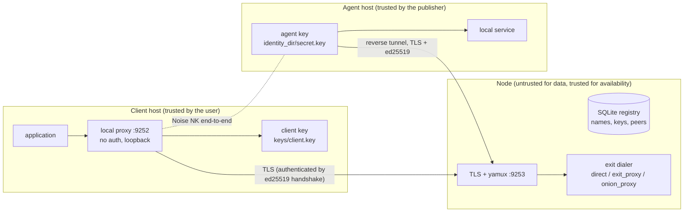

# Threat model

Status: initial, reviewed 2026-11-23. Covers the Go daemon in this repository
(node, agent, client and combined roles). The official desktop browser
([SURFACE Browser](https://github.com/krondevs/surface-browser)) and the Android
wrapper are separate attack surfaces with their own policies.

Surface has not been audited. This document describes what the design intends
to protect, what it explicitly does not protect, and where the residual risk
sits, so that operators and reviewers can make an informed decision.

## 1. What Surface is

A private overlay network of `.surface` names plus an optional clearnet exit:

- **node** — public relay, registry and internet exit (`node.go`),
- **agent** — publishes one or more `.surface` services through a reverse
  tunnel (`agent.go`),
- **client** — local SOCKS5/HTTP proxy on `127.0.0.1:9252` (`client.go`,
  `proxy.go`),
- **combined** — client and agent in one process, the default when no
  subcommand is given (`run.go`).

Front-ends: the Go binary itself (CLI), the official
[SURFACE Browser](https://github.com/krondevs/surface-browser) (Chromium/Electron
desktop shell that embeds the client) and the Android app/`Termux` installer,
which run the same client behind a foreground service or a local SOCKS5 proxy.

Transport is TLS with yamux multiplexing. `.surface` payloads additionally run
inside an end-to-end Noise channel between client and agent, so the relay sees
ciphertext only. There is exactly one hop.

## 2. Trust boundaries

Trust boundaries:

1. **Client host → node.** The node is authenticated by TLS pinning only in
   `node_auth: "pinned"`. In the default `node_auth: "none"` the node is not
   authenticated at all; the TLS layer only provides transport encryption.
   The client's identity is proven to the node by an ed25519 signature
   (`peerHandshake` in `tunnel.go`).
2. **Agent host → node.** Same handshake, plus the node checks that the
   registered name equals `DeriveName(pub)` (`node.go:154`). The agent never
   accepts inbound connections; it dials out.
3. **Client ↔ agent.** Mutually bound by address: the name is a hash of the
   agent key, and the E2E prologue binds version, name, port and agent key
   (`e2e.go:60`). The node cannot read or redirect the stream without causing a
   handshake failure.
4. **Node ↔ internet.** The node is the exit. It can read clearnet HTTP, and it
   resolves DNS when no `exit_proxy` is configured.
5. **Node ↔ peer nodes.** Signed JSON envelopes (`discovery.go`, `peer.go`),
   verified by callback challenge. Seeds are not trusted for identity, only for
   discovery.

## 3. Assets

| Asset | Where | Impact if compromised |
| --- | --- | --- |
| Agent identity (`identity_dir/secret.key`) | agent host | Full impersonation of the `.surface` name; decrypts future sessions; address changes if lost |
| Client identity (`keys/client.key`) | client host | Impersonation of an authorized client; access to the node's exit |
| Node identity (`keys/node.key`) | node host | Impersonation in peer discovery; forged announcements |
| Node TLS key (`certs/node.key`) | node host | Node impersonation in `pinned` mode; no data impact in `none` mode |
| Peer request key (`keys/peer.key`) | client/agent host | Ability to request peer lists (no data access) |
| Service content | client ↔ agent | Confidentiality and integrity of `.surface` traffic |
| Metadata (service name, IPs, timing, volume) | node | Correlation and traffic analysis; not hidden by design |
| Registry state (SQLite) | node | Service routing integrity, authorization decisions |
| Clearnet traffic | node | Readable/modifiable if plain HTTP; HTTPS protects content |
| Availability | all | A node, seed or relay can deny service |

## 4. Adversaries

| ID | Adversary | Capabilities | Primary mitigations | Residual risk |
| --- | --- | --- | --- | --- |
| A1 | Passive network observer / ISP | Sees IPs, ports, TLS records, timing, volume | TLS 1.2+ for transport; Noise for `.surface` payloads | Traffic analysis, SNI-like metadata is limited (no SNI verification) but flow correlation remains; `.surface` names are not in DNS |
| A2 | Malicious or compromised node operator | Terminates TLS, controls registry, exit, logs | `.surface` E2E (Noise NK, name-bound prologue), fail-closed on E2E | Sees names, IPs, timing, volume; can drop/delay; clearnet HTTP readable; can substitute clearnet exit when `node_auth: none` |
| A3 | Active network attacker (on-path) | Can MITM the TLS session when verification is skipped | `node_auth: "pinned"` with `tls_skip_verify: false` | In the default `none` mode an on-path attacker can impersonate a node; `.surface` content stays confidential to the agent key, but availability and clearnet routing are not protected |
| A4 | Malicious peer node | Announces false addresses, returns poisoned peer lists, attempts to make clients scan internal networks | Callback challenge, public-IP-only validation, per-IP rate limits, TTL, DB cap, key-change detection per address, allowlists | A seed can censor or eclipse discovery; a returned peer is still verified by callback; discovery is not a DHT |
| A5 | Unauthorized client or agent | Tries to register a name or use the exit | ed25519 handshake, name = `DeriveName(key)`, `allowed_agents` / `allowed_nodes` / client key table | Open by default when the allowlists are empty; no per-service client auth |
| A6 | Abusive authorized client | Uses the node as an open proxy (spam, scans, abuse) | Registry-based authorization, operator ACLs, `exit_proxy`/firewall, logs | No built-in abuse detection, quota or accounting; legal responsibility sits with the node operator |
| A7 | Malicious `.surface` publisher | Publishes a service that attacks clients (protocol confusion, huge responses) | E2E authenticated to the name; client only speaks TCP to the target; TLS/Noise framing limits | The application protocol is the client's problem; a service can still send arbitrary bytes after connect |
| A8 | Local attacker on a client/agent host | Reads keys, logs, registry cache | Keys `0600`, dirs `0700`, peer cache atomic `0600`, Android app storage private | `surface.log` is `0644` and contains metadata; root can read everything; no HSM/TPM support |
| A9 | Malicious or unavailable seeds | Withhold peers, delay, return decoys | Multiple seeds, local peer cache, discovery degrades to configured `node_addrs` | Censorship and eclipse are possible; seeds are a centralization point |
| A10 | Node operator under legal pressure | Logs, blocks, discloses | Zero trust for `.surface` data; no account system; minimal metadata | Metadata disclosure is possible by design |

## 5. Assumptions

- ed25519, X25519, ChaCha20-Poly1305, BLAKE2s, TLS 1.2+ and the Noise
  implementation (`github.com/flynn/noise`) behave as specified. See
  [`CRYPTO.md`](CRYPTO.md).
- `crypto/rand` is a secure randomness source. `math/rand` is used only for
  gossip jitter and peer shuffle, never for keys or nonces.
- Node, client and agent hosts are not already compromised and the operator
  protects the key directory.
- Clocks are within ±5 minutes; peer announcements and challenges are rejected
  outside that window (`peerTimestampSkew`).
- The operator chooses honest DNS resolvers. When no `exit_proxy` is set, the
  node resolves names with `dns_servers`; with a SOCKS5/HTTP `exit_proxy` the
  hostname is sent to the proxy instead.
- Tor is installed and trusted if `.onion` destinations are used. `.onion`
  never falls back to a direct connection (`exit.go:91`).

## 6. Path-by-path analysis

### 6.1 `.surface` request (the protected path)

1. The client proxy resolves the name locally, picks a node per
   `node_strategy`, and opens a yamux stream.
2. It sends a v2 request (`protocol.go`) with the host and port.
3. The node looks up `(name, virtual_port)` in the registry and requires the
   agent session to have registered `E2E: true`. Otherwise it fails with
   `respE2EUnavailable`; there is no plaintext fallback.
4. The node returns `respOK` with the agent's ed25519 key and the E2E version,
   then relays bytes between client and agent.
5. The client verifies `DeriveName(pub) == name`, runs Noise NK with the
   prologue `surface-e2e-v1|name|port|hex(pub)`, and only then exchanges data.

What the node learns: client IP, agent IP, name, virtual port, timing, byte
counts, connection count. What it cannot do: read or modify payloads, redirect
to another name or port, substitute the agent key, or downgrade to plaintext.

### 6.2 Clearnet request

The node dials the destination directly, through `exit_proxy`, or through Tor
for `.onion`. Consequences:

- HTTPS content is protected by TLS to the destination; the node sees the
  destination host.
- Plain HTTP is readable and modifiable by the node.
- With `node_auth: "none"`, an active attacker who impersonates the node also
  becomes the clearnet exit. This is the main reason to use `pinned` mode for
  networks where clearnet integrity matters.
- When `exit_proxy` fails and `exit_proxy_fallback_direct` is true, the node
  falls back to a direct connection and the system resolver. This can leak the
  destination to local DNS; leave the fallback off in censored environments.
- There is no per-request ACL: any authorized client can reach any host and
  port the node can reach.

### 6.3 `.onion` request

Only `socks5://` is accepted as `onion_proxy`. The hostname is sent to Tor, so
the node does not resolve it, and there is no direct fallback. A failure is
reported as `respExitUnavailable`. Onion routing is off unless Tor is
configured. Tor adds latency and does not make the `.surface` side anonymous.

### 6.4 Peer discovery

Nodes announce to seeds with a signed envelope, are verified by a callback
challenge to the announced address, and then gossip signed peer lists. Clients
and agents pull lists, re-verify each entry by callback, and cache the result.

Limits that bound abuse: announcements and challenges must be fresh (±5 min),
peer addresses must be literal public IPs unless `peer_allow_private` is set,
per-IP rate limits on announcements (30 s) and peer list requests (20 s), at
most 5 callbacks per merge, at most 200 peers per list, at most 5000 rows per
node, 7-day TTL. A node whose key changes for a known address is ignored for
that address.

Residual: discovery is not a DHT and not anonymous. Seed operators see which
nodes announce and can censor. A malicious node can return decoy addresses, but
each decoy must pass a callback signed by its claimed key.

## 7. Known gaps

These are accepted today and are candidates for the roadmap. They are not
vulnerabilities under this threat model, but they are real limits:

1. **No per-service authorization.** Anyone who knows a `.surface` name can
   connect; the agent cannot identify the client. DoS by authorized or
   unauthenticated clients is possible.
2. **Open by default.** Empty `allowed_agents`, `allowed_nodes` and client key
   table mean open registration. This is intentional for bootstrapping.
3. **No padding or cover traffic.** Ciphertext length and timing are visible to
   the relay.
4. **No stream quotas.** An authorized client can open many yamux streams; a
   registered agent can declare many services. Registration JSON is capped at
   64 KiB but the service count is not.
5. **Registration is last-write-wins per `(name, virtual_port)`.** The same key
   re-registering a service replaces the session mapping; it cannot hijack
   another key's name because of the `DeriveName` check.
6. **No revocation CLI.** Keys can be disabled in the database
   (`NodeKey.Enabled`), and `surface node allow` adds them, but there is no
   `deny`/`revoke` subcommand yet. Rotating an identity means a new directory
   and a new name.
7. **`tls_skip_verify: true` overrides pinning.** In `dialTLSAddr`, either
   `tls_skip_verify` or `node_auth: "none"` disables certificate verification.
   Do not combine `pinned` with `tls_skip_verify: true`.
8. **No audit log or metrics endpoint beyond `/healthz`.** Abuse detection is
   the operator's job.
9. **Clearnet exit trust is binary.** A node either sees clearnet plaintext or
   it does not; there is no per-destination split beyond `.surface` / `.onion` /
   everything else.
10. **No post-quantum protection.** X25519 and ed25519 only.
11. **Metadata in logs.** `surface.log` records names and peer addresses.
12. **TCP only.** No UDP ASSOCIATE, QUIC or ICMP.

## 8. Non-goals

Surface does not attempt to provide:

- anonymity or unlinkability against a global observer,
- resistance to targeted traffic correlation,
- censorship resistance against an adversary that can block all seeds and
  known node addresses,
- protection of cleartext application protocols,
- endpoint security or malware protection,
- anonymity for the node operator,
- a trustless exit: the node is trusted for availability and for clearnet
  reachability,
- multi-hop routing (single hop is a deliberate design choice).

## 9. Verification

The claims above are backed by tests in `e2e_test.go`, `onion_test.go`,
`peer_test.go`, `peer_discovery_test.go` and `surface_test.go`, in particular:

- `TestNoiseRelaySeesNoPlaintext` — the relay only observes ciphertext.
- `TestNoisePrologueMismatchFails`, `TestNoiseWrongAgentKeyFails` — binding to
  name/port/key.
- `TestNodeRejectsPlaintextSurface` — no plaintext fallback for `.surface`.
- `TestNodeAuth`, `TestClientAuthorization` — authorization paths.
- `TestPinnedCertificateVerification`, `TestNodeV1ClearnetCompatibility` — TLS
  pinning and protocol compatibility.
- `TestInternetDialerOnionDoesNotFallbackToClearnet` — no onion leak on failure.
- `TestPeerDiscoveryBetweenNodes`, `TestPeerStoreLifecycle`,
  `TestPeerDiscoveryConflictKeepsExistingKey` — discovery verification and
  key-change handling.

Absence of a test is absence of evidence, not evidence of absence. Independent
review is explicitly requested.

## 10. Reviewing and updating this document

Update this file when a trust boundary, an asset, an adversary capability or a
known gap changes. Protocol changes must update
[`PROTOCOL.md`](PROTOCOL.md); cryptographic changes must update
[`CRYPTO.md`](CRYPTO.md). Security-relevant changes should say so in the commit
message and in the pull request.
